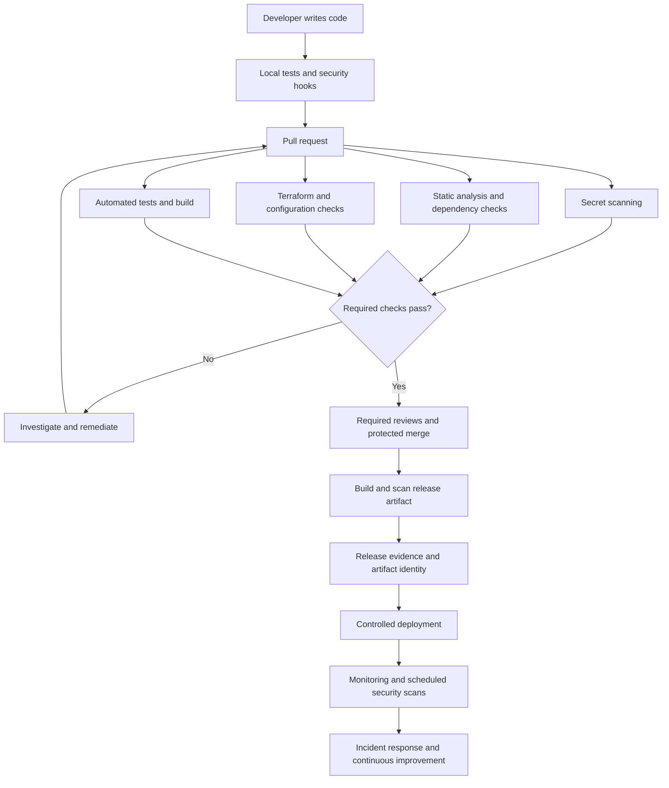

# DevSecOps Security Starter

A reusable, security-first repository for integrating **DevSecOps practices across the Software Development Life Cycle (SDLC)**. This starter provides configurable security controls for source code, dependencies, secrets, containers, Infrastructure as Code (IaC), Kubernetes, and CI/CD pipelines.

The objective is to help developers build security into everyday engineering workflows rather than treating it as a final deployment-stage activity.

> **Project status:** Learning and portfolio starter. Review, test, and adapt all workflows, configurations, and policies before using them in production.

## Table of Contents

- [Overview](#overview)
- [Objectives](#objectives)
- [Security Controls](#security-controls)
- [Repository Structure](#repository-structure)
- [Architecture and Workflow](#architecture-and-workflow)
- [Prerequisites](#prerequisites)
- [Installation and Setup](#installation-and-setup)
- [Running Security Checks](#running-security-checks)
- [GitHub Repository Security](#github-repository-security)
- [Integrating into Existing Projects](#integrating-into-existing-projects)
- [Security Policies and Vulnerability Management](#security-policies-and-vulnerability-management)
- [SBOM and Software Supply Chain Security](#sbom-and-software-supply-chain-security)
- [Kubernetes and Infrastructure Security](#kubernetes-and-infrastructure-security)
- [Security Limitations](#security-limitations)
- [Implementation Roadmap](#implementation-roadmap)
- [Portfolio and Interview Evidence](#portfolio-and-interview-evidence)
- [Contributing](#contributing)
- [License](#license)

## Overview

Modern applications depend on source code, third-party packages, container images, cloud infrastructure, CI/CD automation, and deployment credentials. Each dependency introduces potential security risks.

This repository provides a starting point for implementing repeatable controls that help:

- Prevent accidental exposure of secrets and credentials.
- Detect vulnerable dependencies and insecure code patterns.
- Scan container images and infrastructure configurations.
- Establish automated security gates in CI/CD pipelines.
- Apply repository governance and least-privilege permissions.
- Demonstrate Kubernetes workload hardening.
- Document threat models, exceptions, incident response, and remediation.
- Collect evidence of security checks throughout the delivery lifecycle.

## Objectives

The repository is designed around five engineering objectives:

1. **Prevention:** Reduce the likelihood of introducing secrets, insecure configurations, and vulnerable dependencies.
2. **Detection:** Identify security weaknesses through automated scanning and review.
3. **Enforcement:** Use CI/CD checks and repository rules to prevent unacceptable changes from being merged or released.
4. **Response:** Provide a structured approach to triaging, fixing, and documenting security findings.
5. **Continuous improvement:** Measure control effectiveness and improve the security baseline as projects evolve.

## Security Controls

| Security domain | Tool or mechanism | Purpose |
|---|---|---|
| Source control | `.gitignore` and Git hooks | Reduce accidental commits of generated files and sensitive data |
| Secret scanning | Gitleaks | Detect likely secrets in Git content and history |
| Static application security testing | Semgrep | Detect insecure code patterns |
| Dependency management | Dependabot and dependency review | Identify dependency updates and known vulnerability risks |
| Container security | Trivy | Scan container images and supported artifacts |
| Infrastructure as Code | Checkov | Detect insecure infrastructure configuration |
| CI/CD security | GitHub Actions | Automate security checks and release workflows |
| Repository governance | CODEOWNERS and branch protection | Establish review requirements and protected branches |
| Kubernetes security | Pod security settings and NetworkPolicy examples | Demonstrate workload restrictions and network segmentation |
| Cloud security | Terraform examples | Illustrate secure infrastructure configuration |
| Security governance | Policies, exception register, and runbooks | Support risk decisions and incident response |
| Supply-chain security | SBOM and provenance guidance | Improve software component visibility and artifact traceability |

The exact coverage depends on each tool's configuration, version, workflow permissions, and the files being scanned.

## Repository Structure

```text
devsecops-security-starter/
├── .github/
│   ├── CODEOWNERS
│   ├── dependabot.yml
│   ├── PULL_REQUEST_TEMPLATE.md
│   └── workflows/
│       ├── ci-security.yml
│       ├── secret-history.yml
│       ├── terraform-security.yml
│       ├── container-release.yml
│       └── scheduled-security.yml
├── .githooks/
│   └── pre-commit
├── docs/
│   ├── branch-protection.md
│   ├── incident-response.md
│   ├── security-gates.md
│   ├── secrets-management.md
│   ├── sbom-and-provenance.md
│   ├── threat-model.md
│   ├── vulnerability-management.md
│   └── evidence-checklist.md
├── examples/
│   ├── docker/
│   ├── kubernetes/
│   └── terraform/
├── scripts/
│   ├── install-tools.sh
│   ├── local-security-checks.sh
│   └── verify-release-inputs.sh
├── security/
│   ├── checkov.yml
│   ├── gitleaks.toml
│   ├── semgrep.yml
│   ├── security-policy.yml
│   ├── trivy.yaml
│   └── exceptions.example.yml
├── .gitignore
├── .pre-commit-config.yaml
└── README.md
```

Use the repository's actual directory contents as the source of truth if files are renamed or workflows change.

## Architecture and Workflow

The intended security workflow integrates checks from local development through release and ongoing maintenance.



**Important:** Workflow files alone do not enforce every control in this diagram. Branch protection, required status checks, workflow permissions, environment protection, and deployment credentials must also be configured in GitHub and the target infrastructure.

## Prerequisites

Install the tools required for the checks you intend to run:

- Git
- Python 3 and `pip`
- pre-commit
- Gitleaks
- Trivy
- Semgrep
- Checkov
- Docker, for container examples
- Terraform, for Terraform examples
- A GitHub repository, for CI/CD workflows

Review `scripts/install-tools.sh` before executing it. Installation methods may differ between Windows, Linux, macOS, and CI runners.

## Installation and Setup

### 1. Initialise or clone the repository

If you have cloned the repository:

```bash
cd devsecops-security-starter
```

If you are applying the starter to an existing application, copy the required files into that project and review any conflicting configurations before proceeding.

### 2. Enable Git hooks

From the repository root:

```bash
git config core.hooksPath .githooks
```

This configures Git to use the repository's local hook directory.

Local hooks can be bypassed, so they must be complemented by server-side checks and protected branches.

### 3. Install pre-commit

```bash
python -m pip install pre-commit
pre-commit install
```

Review `.pre-commit-config.yaml` and confirm that the configured hook repositories, revisions, and commands are appropriate for your environment.

### 4. Install the required security tools

Use the provided helper script if its installation methods match your operating system:

```bash
bash scripts/install-tools.sh
```

Alternatively, install the tools individually using their official documentation.

### 5. Execute local security checks

```bash
bash scripts/local-security-checks.sh
```

Run this command from the repository root. Some checks may require additional dependencies or adaptation to the target application's language and directory structure.

### 6. Configure the remote repository

If you are creating a new GitHub repository:

```bash
git init
git add .
git commit -m "chore: establish DevSecOps security baseline"

git branch -M main
git remote add origin <YOUR_REPOSITORY_URL>
git push -u origin main
```

Replace `<YOUR_REPOSITORY_URL>` with the actual repository URL.

After pushing, inspect the GitHub Actions results and verify that the intended checks execute successfully.

## Running Security Checks

Run security checks throughout development instead of relying exclusively on a final pre-release scan.

### Secret scanning

Gitleaks can help identify likely secrets in Git content and history.

```bash
gitleaks git .
```

Use the configuration in `security/gitleaks.toml` where supported by the installed version.

If a real credential is exposed, revoke or rotate it immediately and investigate possible misuse. Removing it from the latest commit does not invalidate the credential or necessarily remove it from Git history.

### Static analysis

Semgrep identifies code patterns that may indicate security weaknesses.

```bash
semgrep scan --config auto .
```

Review the results in the context of the application's language, architecture, and threat model. Automated findings require triage; they are not all confirmed vulnerabilities.

### Container scanning

Scan the image intended for release:

```bash
trivy image <IMAGE_NAME>
```

Replace `<IMAGE_NAME>` with the actual image name and tag or digest.

Prefer scanning the exact artifact that will be deployed. Define which findings block releases and document the process for handling exceptions.

### Infrastructure-as-Code scanning

For Terraform examples:

```bash
checkov -d examples/terraform
```

Review any configuration options in `security/checkov.yml` and confirm that the scanner covers the intended directories.

### Interpreting results

For every significant finding:

1. Confirm whether it is valid and applicable.
2. Assess severity, exploitability, exposure, and business impact.
3. Assign a responsible owner.
4. Remediate the root cause.
5. Re-run the relevant check.
6. Retain evidence of the finding and resolution.

Do not suppress findings merely to obtain a successful pipeline.

## GitHub Repository Security

Security automation must be combined with repository-level governance.

### Branch protection

Protect `main` and relevant release branches with appropriate rules:

- Require pull requests before merging.
- Require appropriate reviewer approval.
- Require CODEOWNERS review for sensitive paths.
- Require the relevant CI and security status checks.
- Require review conversations to be resolved.
- Restrict force pushes and branch deletion.
- Apply administrator restrictions where appropriate.

Verify the exact status-check names after the workflows have executed. Configure the rules in GitHub settings or repository rulesets.

### Workflow permissions

Apply the principle of least privilege to `GITHUB_TOKEN` and other credentials.

- Prefer read-only permissions by default.
- Grant write permissions only to jobs that require them.
- Separate scanning, artifact publishing, and deployment permissions where practical.
- Protect deployment environments.
- Avoid exposing production secrets to untrusted pull-request workflows.
- Prefer short-lived cloud credentials through OIDC federation when supported.

### Third-party GitHub Actions

For production pipelines, pin third-party actions to verified full commit SHAs and maintain an update process. Tags are convenient but can be moved.

Review action permissions, release history, dependencies, and maintenance status before introducing them into sensitive workflows.

### Secrets management

Do not commit real credentials, private keys, tokens, or production `.env` files.

Use an appropriate secret manager or protected GitHub Actions secrets and environments. Prefer scoped, short-lived credentials over long-lived access keys whenever practical.

See `docs/secrets-management.md` for additional guidance.

## Integrating into Existing Projects

When reusing this starter for a full-stack application, API, AI service, containerised workload, or cloud deployment, follow a structured process.

1. **Inventory assets:** Identify source code, packages, secrets, images, infrastructure, databases, and deployment environments.
2. **Define the threat model:** Record trust boundaries, entry points, sensitive data, and likely abuse cases.
3. **Select security checks:** Choose relevant tests, secret scanning, SAST, dependency scanning, container scanning, and IaC checks.
4. **Set security gates:** Decide which findings block merging or releasing.
5. **Apply least privilege:** Restrict workflow permissions, runtime identities, cloud IAM, and network access.
6. **Enforce governance:** Configure branch protection, CODEOWNERS, approvals, and deployment controls.
7. **Validate coverage:** Confirm that checks scan the correct languages, directories, artifacts, and configurations.
8. **Record evidence:** Retain relevant scan results, artifact identifiers, remediation records, and approvals.

Avoid copying example configurations blindly. Application requirements, cloud architecture, and security risks differ between projects.

## Security Policies and Vulnerability Management

The `security/` directory contains configurable policy files and an example exception register.

When managing vulnerabilities, establish:

- Severity and risk-assessment criteria.
- Remediation ownership.
- Remediation deadlines or service-level objectives.
- Escalation procedures for overdue critical findings.
- Rules for accepting and documenting residual risk.
- Periodic review of outstanding exceptions.

Any exception should document the affected asset, finding, justification, compensating controls, approver, owner, and expiry or review date.

The example exception register is a documentation aid. It does not automatically enforce approvals or policy decisions unless additional automation is implemented.

See:

- `docs/security-gates.md`
- `docs/vulnerability-management.md`
- `docs/incident-response.md`

## SBOM and Software Supply Chain Security

A Software Bill of Materials (SBOM) describes software components included in an artifact. Provenance records information about how an artifact was built and can help establish its relationship to source code and CI workflows.

For stronger supply-chain security:

- Generate an SBOM for the actual release artifact.
- Scan the artifact that will be deployed.
- Record the source commit and artifact digest.
- Restrict artifact publishing permissions.
- Where feasible, generate and verify signed provenance or attestations.
- Retain release evidence in an access-controlled location.
- Establish a process for responding to newly disclosed dependency vulnerabilities.

See `docs/sbom-and-provenance.md`.

**Note:** Documentation about SBOMs and provenance does not itself mean that generation, signing, or verification has been implemented end to end.

## Kubernetes and Infrastructure Security

The examples provide a starting point for exploring secure configuration practices.

### Kubernetes

Review the example manifests for controls such as:

- Restricted namespace or workload settings.
- Non-root execution and restricted container privileges.
- Default-deny ingress network policy.
- Explicit network access allowances.
- Resource requests and limits, where appropriate.

Validate manifests against the target Kubernetes version and cluster configuration. A default-deny ingress policy can block legitimate application traffic unless required allowances are configured.

These examples do not constitute a complete Kubernetes production-hardening solution.

### Terraform and cloud infrastructure

Use the Terraform examples to explore secure infrastructure configuration and automated IaC checks.

Before deploying real infrastructure, review:

- IAM permissions and trust relationships.
- Storage access policies and encryption.
- Network exposure and security groups.
- Terraform state storage, access, and locking.
- Secret handling and provider configuration.
- Logging, monitoring, backups, and recovery.
- Environment separation and change approvals.

Test infrastructure changes in a non-production environment before promoting them.

## Security Limitations

This repository is a security engineering starter, not a guarantee that an application is secure or compliant.

- Automated scanners can produce false positives and miss vulnerabilities.
- Local Git hooks can be bypassed.
- CI workflows do not replace repository rules or access controls.
- Example manifests and Terraform files may require substantial adaptation.
- Cloud IAM, runtime monitoring, backups, disaster recovery, and incident response still need implementation and testing.
- Tool versions, configuration schemas, and security recommendations change over time.
- Passing security checks does not replace code review, threat modelling, penetration testing where appropriate, or professional security assessment.

Before production adoption, review all workflows and scripts, pin and maintain dependencies, validate permissions, configure branch rules, and test the controls.

## Implementation Roadmap

### Phase 1: Repository hygiene

- [ ] Maintain `.gitignore`.
- [ ] Enable local hooks and Gitleaks.
- [ ] Scan Git history and document credential-exposure response.
- [ ] Configure CODEOWNERS and branch protection.

### Phase 2: Application and dependency security

- [ ] Add automated tests.
- [ ] Configure static analysis and dependency checks.
- [ ] Establish vulnerability severity criteria and remediation targets.
- [ ] Configure scheduled scans and exception handling.

### Phase 3: Build and supply-chain security

- [ ] Build and scan container images.
- [ ] Define release-blocking criteria.
- [ ] Generate an SBOM for release artifacts.
- [ ] Pin third-party GitHub Actions to verified full SHAs.
- [ ] Minimise CI permissions and protect publishing credentials.

### Phase 4: Infrastructure and runtime security

- [ ] Add IaC scanning and infrastructure reviews.
- [ ] Apply least-privilege IAM and secure Terraform state.
- [ ] Harden Kubernetes workloads and validate network policies.
- [ ] Implement logging, monitoring, alerting, and backup/restore tests.
- [ ] Exercise incident-response and recovery procedures.

### Phase 5: Evidence and continuous improvement

- [ ] Preserve representative passing and failing test evidence.
- [ ] Document remediation examples and security decisions.
- [ ] Review exceptions and policies regularly.
- [ ] Track unresolved risks and planned improvements.

## Portfolio and Interview Evidence

Use this repository to demonstrate engineering decisions and measurable outcomes, not just familiarity with tools.

Strong portfolio evidence includes:

- A threat model showing assets, trust boundaries, and attack scenarios.
- A pull request blocked by a reproducible test finding, followed by a fix.
- A safe secret-scanning demonstration using a clearly fake test token.
- A dependency or container vulnerability triage example.
- An IaC finding and the remediation that resolved it.
- Documentation of branch protection and CODEOWNERS.
- An SBOM linked to a specific artifact digest.
- A review of CI workflow permissions and credential handling.
- An incident-response runbook and a documented tabletop exercise.
- A record of security trade-offs, exceptions, false positives, and residual risks.

Never publish live credentials, private customer data, sensitive logs, or unredacted infrastructure details as portfolio evidence.

## Contributing

1. Open an issue describing the proposed improvement or security concern.
2. Create a focused branch.
3. Run the relevant local checks and tests.
4. Explain the security rationale and compatibility impact in the pull request.
5. Update documentation alongside configuration changes.

Changes to security workflows require particular care because a workflow modification can weaken the very controls it is intended to enforce.

## License
Copyright © 2026 Jonkidera.

This repository is distributed under the Jonkidera Copyright and Distribution License. You may use, copy, modify, and redistribute the repository, including for commercial purposes, provided that you retain the copyright notice, include the license, and identify substantial modifications.
